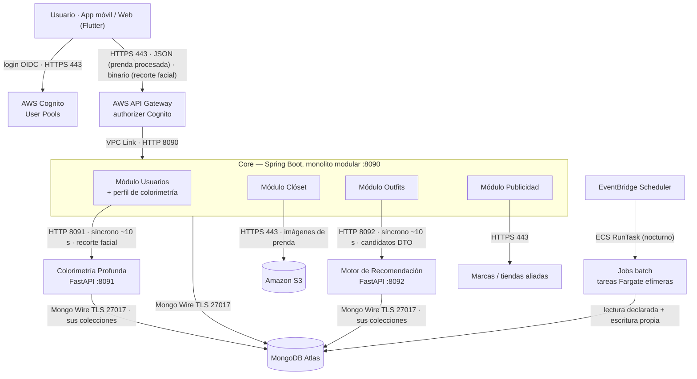
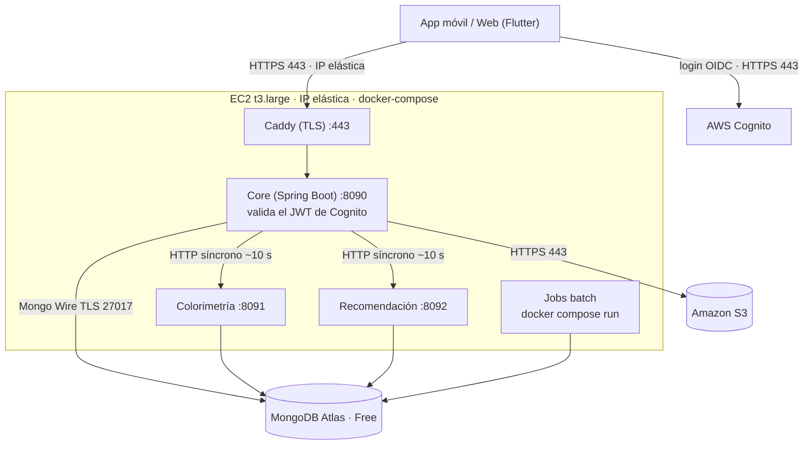

# WearHack — Protocolos y Puertos del Sistema

**Proyecto:** WearHack — Tu clóset, potenciado por inteligencia artificial
**Documento:** Especificación de Protocolos de Comunicación y Puertos
**Versión:** actualizada el 2026-09-28 (sustituye a la versión con seis microservicios de negocio)

---

## 0. Cambios respecto a la versión anterior

| Tema | Antes | Ahora |
|---|---|---|
| Backend de negocio | 4 microservicios Spring Boot (puertos 8081-8084) | **Core**: un solo despliegue Spring Boot (monolito modular) con los módulos Usuarios, Clóset, Outfits y Publicidad, en el puerto 8090 |
| Autenticación | JWT emitido por el Servicio de Usuarios | **AWS Cognito** (User Pools) emite el JWT; el módulo Usuarios solo gestiona perfil y el vínculo con el `sub` |
| API Gateway | Gateway genérico, con un puerto interno opcional (8080) | **AWS API Gateway** con authorizer nativo de Cognito, integración privada hacia el Core |
| Colorimetría | La llama el Servicio de Clóset; asíncrona (202 + polling) | La llama el **módulo Usuarios**; **síncrona** con timeout de ~10 s |
| Motor de Recomendación | Asíncrono (202 + polling); lee las prendas directamente de MongoDB | **Síncrono**; el Core le envía los candidatos como DTO tipado; el motor no accede a colecciones del Core |
| Jobs batch | Procesos programados (cron / APScheduler / Celery beat) | **EventBridge Scheduler → ECS RunTask**: tareas Fargate efímeras |
| MongoDB | Servicio interno en el puerto 27017 | **MongoDB Atlas**: servicio externo gestionado, por TLS |
| Object storage | MinIO o S3 compatible | **Amazon S3** (MinIO solo en desarrollo local) |
| Caché Redis (6379) | Opcional, para sesiones/tokens | **Eliminado**: Cognito gestiona sesiones y tokens; no hay caché definida |
| Observabilidad | Logs de los jobs (mensaje JSON) | Además: **OpenTelemetry (ADOT)** como sidecar por tarea |
| Recorte facial | Se almacenaba en S3 con retención y acceso restringidos | **No se persiste**: se procesa en memoria y se descarta; solo se guardan los valores derivados y el resultado. Colorimetría opcional; solo mayores de 18 en el MVP (ver `politica-datos-colorimetria-wearhack.md`) |
| Puerto del Core | — | **8090** (decidido 2026-10-01, alineado con el repositorio) |
| Entorno actual | No definido | Las secciones 1 a 10 describen la **arquitectura objetivo**. El MVP corre en el **AWS Academy Learner Lab** con una topología simplificada (EC2 único con docker-compose): ver sección 11 |

---

## 1. Objetivo del documento

Definir **qué protocolos usa cada componente de WearHack para comunicarse**, **por qué puerto** lo hace, y **qué formato de datos** viaja en cada canal, alineado con la arquitectura del sistema (cliente grueso con IA on-device, API Gateway, Core modular, servicios de IA síncronos, jobs batch nocturnos y capa de datos).

## 2. Alcance

Cubre la comunicación entre:
- El cliente móvil (con su pipeline de IA on-device) y el sistema.
- El cliente y Cognito (registro e inicio de sesión).
- El API Gateway y el Core (Spring Boot).
- El Core y los servicios de IA (Python/FastAPI).
- Los jobs batch nocturnos y la capa de datos.
- La capa de datos (MongoDB Atlas + Amazon S3).

No cubre infraestructura de despliegue (CI/CD, definición de tareas ECS, diseño de red de la VPC), que se documenta en el documento de stack tecnológico.

---

## 3. Resumen de la arquitectura (para contexto de este documento)

```
Usuario
  │
  ▼
[1] Capa de presentación — Cliente grueso (mobile-first)
    · App móvil (Flutter/Dart, Android/iOS) — TFLite/LiteRT on-device:
        remoción de fondo (u2netp) · color base · tipo/textura/patrón (MobileNetV3-Small)
        · detección + recorte facial (ML Kit)
    · App web (Flutter Web) — solo consulta/gestión, mismos endpoints, sin captura ni IA propia
  │   (login: directo contra Cognito)
  │   (envía: metadatos + imagen procesada → Clóset | recorte facial normalizado → Usuarios/colorimetría)
  ▼
[2] Capa de entrada — AWS API Gateway (enrutamiento, authorizer de Cognito) + AWS Cognito (User Pools)
  │
  ▼
[3] Core — Spring Boot, monolito modular (un solo despliegue, puerto 8090)
    · Módulos: Usuarios (incluye perfil de colorimetría) · Clóset · Outfits · Publicidad
  │
  ├─ HTTP síncrono ──► [4] Servicios de IA — Python/FastAPI
  │                        · Colorimetría Profunda (recibe solo el recorte facial)
  │                        · Motor de Recomendación Combinatoria (recibe los candidatos en la petición)
  │
  ├─ Jobs batch nocturnos — EventBridge Scheduler → ECS RunTask (tareas efímeras)
  │        · Recalibración de centroides de temporada · Ranking de prenda puente · Ajuste de preferencias
  │        (los centroides de color de prenda los recalibra el Core, módulo Clóset)
  ▼
[5] Capa de datos
    · MongoDB Atlas (servicio externo, TLS): usuarios, colorimetría, prendas, outfits, correcciones,
      configuración, catálogos, y las colecciones propias de la IA
    · Amazon S3: imágenes de prenda procesadas (el recorte facial no se persiste)
```

---

## 4. Protocolos por canal

| Canal de comunicación | Protocolo | Formato de datos | Justificación |
|---|---|---|---|
| Cliente ↔ Cognito (registro e inicio de sesión) | **HTTPS + OAuth 2.0 / OIDC** (Hosted UI, redirección nativa vía AWS Amplify Flutter); login con correo, Google y Apple | JSON / tokens JWT | El inicio de sesión no pasa por el API Gateway ni por el Core. Cognito emite un JWT estándar con JWKS público. |
| Cliente ↔ API Gateway (prenda) | **HTTPS sobre TLS** (política de seguridad mínima TLS 1.2; 1.3 donde el endpoint lo ofrezca) | JSON (metadatos: `slot_outfit`, formalidad, estado, atributos) + binario (imagen ya procesada, sin fondo) | El procesamiento pesado ya ocurrió on-device; viaja una imagen liviana y metadatos estructurados. |
| Cliente ↔ API Gateway (recorte facial) | **HTTPS/TLS**, ruta separada de la de la prenda | Binario (recorte facial normalizado) | Dato sensible: viaja únicamente hacia el módulo Usuarios y de ahí a Colorimetría; nunca la foto completa. **No se persiste** (ni disco, ni S3, ni logs) y solo se envía si hay un consentimiento vigente (ver `politica-datos-colorimetria-wearhack.md`). |
| Cliente ↔ notificaciones | No requerido | — | Con las llamadas en línea síncronas no hace falta avisar al cliente. Si un flujo pasa a asíncrono en el futuro, la opción sería WebSocket API de API Gateway o polling HTTP. |
| API Gateway ↔ Core | **HTTP/1.1 REST**, integración privada por VPC Link (red privada) | JSON | Un único destino. Las rutas `/api/v1/{usuarios,closet,outfits,publicidad}` se resuelven dentro del Core, una por módulo. El destino del VPC Link (balanceador o descubrimiento de servicios) depende del diseño de red pendiente. |
| Core (módulo Usuarios) ↔ Colorimetría Profunda | **HTTP REST síncrono**, timeout ~10 s | Petición: binario (recorte facial). Respuesta: JSON (temporada, ejes usados, confianza) | El usuario espera el resultado durante el onboarding y el cómputo es pequeño. Pasa a asíncrono solo si el p95 supera ~3-5 s o si ráfagas de onboarding saturan las tareas. |
| Core (módulo Outfits) ↔ Motor de Recomendación | **HTTP REST síncrono**, timeout ~10 s | Petición: JSON con candidatos como DTO tipado y contexto. Respuesta: JSON con outfits candidatos y scores | Frontera explícita y validada; el motor se prueba como función pura. El DTO mapea directo a protobuf si algún día se migra a gRPC. |
| Servicios de IA ↔ MongoDB Atlas | **MongoDB Wire Protocol sobre TLS** (`mongodb+srv`, puerto 27017) | BSON | Cada servicio accede solo a sus propias colecciones (centroides, pesos, coocurrencia de texturas, ranking). |
| Core ↔ MongoDB Atlas | **MongoDB Wire Protocol sobre TLS** (puerto 27017) | BSON | Cada módulo es dueño de sus colecciones y no toca las de otro. |
| Jobs batch ↔ MongoDB Atlas | **MongoDB Wire Protocol sobre TLS** (puerto 27017) | BSON | Lectura declarada (usuario de solo lectura) sobre las colecciones fuente del Core; escritura solo sobre las que producen (ver sección 6). |
| EventBridge Scheduler → ECS RunTask | API de AWS (IAM) | — | Cada job nocturno es una tarea Fargate efímera: misma imagen del servicio de IA con otro comando de arranque. Sin puerto de entrada. |
| Core / servicios de IA / jobs ↔ Amazon S3 | **HTTPS** (API de S3) | Binario (imagen) + JSON (metadatos del objeto) | Almacena imágenes de prenda procesadas. El recorte facial no se almacena. |
| Core (módulo Publicidad) ↔ marcas/tiendas aliadas (externo) | **HTTPS REST o webhooks** | JSON | Solo catálogo; no hay inventario físico en tiempo real ni sincronización de stock. Recibir webhooks exigiría exponer una ruta por el API Gateway: es uno de los disparadores para extraer Publicidad a un servicio propio. |
| Telemetría: Core / servicios de IA → ADOT collector | **OTLP** (gRPC 4317 / HTTP 4318), solo dentro de la tarea | Protobuf / JSON | Colector como sidecar de cada tarea; reenvía a CloudWatch y X-Ray. |

---

## 5. Tabla de puertos por componente

> Único punto de entrada de WearHack desde internet: el **443** del API Gateway. Cognito también se alcanza por 443, pero es un servicio gestionado por AWS. Todo lo demás vive en la red privada, restringido por security groups.

| # | Componente | Puerto | Protocolo | Expuesto públicamente |
|---|---|---|---|---|
| 1 | AWS API Gateway (endpoint gestionado) | **443** | HTTPS/REST | ✅ Sí |
| 2 | AWS Cognito (User Pools / Hosted UI) | 443 | HTTPS / OIDC | ✅ Sí (servicio gestionado por AWS) |
| 3 | Core (Spring Boot, monolito modular) | 8090 | HTTP/REST | ❌ No (solo vía VPC Link) |
| 4 | Colorimetría Profunda (FastAPI) | 8091 | HTTP/REST síncrono | ❌ No |
| 5 | Motor de Recomendación Combinatoria (FastAPI) | 8092 | HTTP/REST síncrono | ❌ No |
| 6 | Jobs batch nocturnos (tareas ECS RunTask) | *sin puerto de entrada* | Salen hacia MongoDB (27017) y S3 (443) | ❌ No |
| 7 | ADOT collector (sidecar por tarea) | 4317 / 4318 | OTLP | ❌ No (solo dentro de la tarea) |
| 8 | MongoDB Atlas | 27017 | MongoDB Wire Protocol sobre TLS | Servicio externo gestionado por Atlas; acceso por lista de IPs permitidas (Flex) o conexión privada (M10+) |
| 9 | Amazon S3 | 443 | HTTPS | Servicio gestionado; acceso por IAM y políticas de bucket |

Solo en desarrollo local (docker-compose): MinIO (9000 API / 9001 consola) como sustituto de S3, y opcionalmente una MongoDB local en 27017. No existen en producción.

---

## 6. Autenticación, control de acceso y acceso a datos

**Autenticación**

- **Cliente → Cognito**: registro e inicio de sesión (correo, Google, Apple). Cognito emite el JWT. Si se ofrece login con Google en iOS, Apple exige ofrecer también "Sign in with Apple".
- **Cliente → API Gateway**: `Authorization: Bearer <token>`. El authorizer nativo de Cognito valida el JWT antes de enrutar.
- **API Gateway → Core**: el Core recibe el token y la identidad (`sub`). Recomendado: que el Core verifique el JWT de nuevo contra el JWKS de Cognito (Spring Security como resource server), como defensa en profundidad. Ver sección 10.
- **Core → servicios de IA**: token de servicio interno (client credentials / API key de servicio), porque estas llamadas no llevan la sesión del usuario final. El `usuario_id` viaja como dato de negocio en la petición, no como credencial.
- **Jobs batch**: rol IAM de la tarea y credenciales de servicio de base de datos con permisos mínimos. Nunca credenciales de usuario.
- **Integración con marcas/tiendas aliadas**: API key u OAuth2 Client Credentials, según cada aliado.

**Acceso a MongoDB Atlas**: un usuario de base de datos por componente (Core, Colorimetría, Recomendación, jobs batch), con TLS. Si Atlas permite restringir por colección en el tier elegido, cada usuario se limita a las colecciones que le corresponden; si no, a permisos por base de datos. En el tier Flex no hay VPC peering, así que se accede por internet con lista de IPs permitidas, lo que exige una IP de salida fija. En M10 se pasa a conexión privada.

**Propiedad de colecciones y acceso de la IA a los datos del Core (híbrido)**

Cada colección tiene un único dueño. Leer la de otro se permite solo por su API o por un contrato de solo lectura declarado.

| Colección | Dueño | Acceso de otros |
|---|---|---|
| Perfil de usuario, perfil de colorimetría (solo valores derivados), `consentimientos` y correcciones de colorimetría | Módulo Usuarios | Job de recalibración de centroides de temporada: solo lectura sobre las correcciones |
| Prendas y `correcciones_clasificacion` | Módulo Clóset | Outfits: por la API del módulo. Jobs batch: solo lectura |
| Outfits y selecciones | Módulo Outfits | Job de ajuste de preferencias: solo lectura |
| Catálogos de marcas aliadas | Módulo Publicidad | Job de ranking de prenda puente: solo lectura |
| Centroides, pesos por usuario y coocurrencia de texturas | Servicios de IA y jobs | Colorimetría y Motor leen las suyas en línea; el Core no las lee |
| `recalibraciones` (marca de qué correcciones consumió cada corrida) | Job de recalibración de centroides de temporada | Módulo Usuarios: solo lectura, contrato declarado, para desvincular las correcciones consumidas |
| Ranking de prenda puente | Jobs batch (Recomendación) | Módulo Publicidad: solo lectura, contrato declarado |
| Centroides de color de prenda (ISCC-NBS, fijos) y tabla de traducción a categorías | Módulo Clóset (la tabla se ajusta por tarea programada del Core) | Nadie más |
| `configuracion` (umbrales, dress codes, pesos) | Un documento por dueño: `outfits`, `colorimetria`, `closet`, `recomendacion` | Cada componente lee y escribe solo su documento |

- **Ruta en línea**: el Core consulta las prendas (índice ESR `usuario_id + slot_outfit + atributos.clima_apto`, que queda en la colección de Clóset) y las envía en la petición. El motor no tiene credenciales sobre colecciones del Core.
- **Jobs batch**: lectura directa declarada como contrato sobre las colecciones fuente. Las prendas llevan un campo de versión de esquema para detectar cambios que rompan ese contrato.

---

## 7. Formato de mensajes y versionado

- Respuestas REST en `application/json`.
- Rutas versionadas, todas resueltas por el Core (un módulo por prefijo): `/api/v1/usuarios`, `/api/v1/closet`, `/api/v1/outfits`, `/api/v1/publicidad`.
- **Endpoints de IA, síncronos**:
  1. `POST /v1/colorimetria/analizar` → `200` con el resultado.
  2. `POST /v1/recomendacion/generar` → `200` con los outfits candidatos.
  - Errores: `422` si el DTO no valida, `503` si el servicio no está disponible. Si vence el timeout (~10 s), el Core responde al cliente con un error controlado y reintentable, sin pérdida de datos.
  - No hay `202` ni `job_id` ni endpoint de estado. Si un flujo pasa a asíncrono, solo cambia el contrato de ese endpoint.
- **Jobs batch**: sin endpoints. Cada uno es un comando de arranque de la imagen del servicio de IA correspondiente (por ejemplo `python -m jobs.<nombre>`). Mensaje de log estructurado por corrida: `{ "job": string, "umbral_alcanzado": number, "usuarios_afectados": number, "timestamp": string }`.

Ejemplo ilustrativo del cuerpo de `POST /v1/recomendacion/generar` (los nombres exactos de los enums se fijan en el modelo de datos):

```json
{
  "usuario_id": "…",
  "contexto": { "ocasion": "…", "mood": "…", "clima": "…", "estacion": "…" },
  "candidatos": [
    {
      "id": "…",
      "slot_outfit": "TORSO_SUPERIOR",
      "lab": [52.1, 3.4, -8.0],
      "tipo": "…",
      "textura": "…",
      "patron": "LISO",
      "formalidad": { "min": "CASUAL", "max": "CASUAL" },
      "clima_apto": ["…"],
      "version_esquema": 1
    }
  ]
}
```

---

## 8. Diagrama de protocolos y puertos



Versión gráfica en el estilo del diagrama anterior: `arquitectura_wearhack_v2.png` (y `.svg`).

---

## 9. Trazabilidad con requisitos del proyecto

| Requisito | Cómo lo cubre este documento |
|---|---|
| RF03 (colorimetría a partir de foto propia) | Canal dedicado para el recorte facial (nunca la foto completa), del cliente al módulo Usuarios y de ahí a Colorimetría Profunda por HTTP REST síncrono. |
| RF04 (categorizar prenda automáticamente) | Ocurre on-device (TFLite/LiteRT); solo se transmite el resultado (metadatos) al módulo Clóset. |
| RNF01 (respuesta ≤ 5 s) | El procesamiento pesado corre local. Las llamadas a IA son síncronas con timeout de ~10 s como techo (criterio de calidad de generación de outfit); el objetivo de respuesta es ≤ 5 s, medible con las trazas de OpenTelemetry. |
| RNF03 (cifrado de datos e imágenes) | TLS en todo canal expuesto al cliente, hacia S3 y hacia MongoDB Atlas; el recorte facial no se persiste, y los valores derivados se guardan en MongoDB con cifrado en reposo. |
| RNF04 (compatibilidad Android/iOS/web) | Contrato REST/JSON único en el API Gateway; el modelo on-device solo corre en mobile, la web reutiliza los mismos endpoints sin IA propia. |
| RNF07 (precisión ≥ 85 % en detección/colorimetría) | Los jobs batch (recalibración de centroides, ajuste de preferencias) mantienen los modelos afinados con datos reales vía correcciones en MongoDB. |
| RNF08 (escalabilidad horizontal) | Core y servicios de IA escalan como servicios ECS independientes; los jobs batch corren como tareas efímeras fuera del camino síncrono. |
| RNF09/RNF10 (logs, integrar nuevas marcas) | Logs en CloudWatch y trazas con OpenTelemetry; cada corrida nocturna deja un log estructurado. El módulo Publicidad expone un canal HTTPS/REST desacoplado. |
| Criterio de calidad 3 (seguridad: 100 % de accesos no autorizados rechazados) | JWT de Cognito validado en el API Gateway (y, recomendado, de nuevo en el Core); cada colección con un único dueño; usuarios de base de datos de mínimo privilegio. |
| Criterio de calidad 4 (fiabilidad) | Timeout explícito en las llamadas a IA con error controlado y reintentable; sin pérdida de datos si un servicio de IA no responde. |

---

## 10. Notas y supuestos

- **Síncrono por defecto**: el timeout de ~10 s en las llamadas a IA está muy por debajo del límite de integración del API Gateway (~30 s). Pasar un flujo a asíncrono (202 + polling) exigiría estado de tarea compartido entre réplicas; solo se justifica si el p95 supera ~3-5 s o si ráfagas de onboarding saturan las tareas.
- **Filtros duros**: como el Core envía los candidatos, los filtros duros (clima apto y dress code) se aplican en la consulta del Core; el motor aplica los suaves (mood y estación) como pesos del score. Es consecuencia del acceso híbrido a los datos.
- **Payload**: el límite de payload del API Gateway (10 MB) alcanza para imágenes ya procesadas. Si crecieran, la alternativa es subir directo a S3 con una URL prefirmada.
- **Verificación del JWT en el Core**: se recomienda, como defensa en profundidad, pero no está confirmada como decisión.
- **Pendientes que afectan este documento**:
  - Diseño de red de la arquitectura objetivo (cuenta propia): destino del VPC Link, IP de salida fija para la lista de acceso de Atlas, y un gateway endpoint de S3.
  - Verificaciones en el Learner Lab (ver sección 11).
  - Política de datos de colorimetría: definida en `politica-datos-colorimetria-wearhack.md`; borrador pendiente de validación legal.
  - Si el tier de Atlas elegido permite roles por colección.
- **Recalibración de centroides**: la de temporada corre como job en la imagen de Colorimetría; la de color de prenda es una tarea programada del Core (módulo Clóset).
- **Scheduler**: el mecanismo exacto de disparo (una definición de tarea por job, rol IAM y configuración de red de la tarea) se detalla en el documento de stack tecnológico y en la infraestructura como código.

---

## 11. Topología del MVP en el AWS Academy Learner Lab (EC2 + docker-compose)

Las secciones 1 a 10 describen la arquitectura objetivo. Mientras el equipo trabaje en un Learner Lab (sesiones de 4 horas, IAM limitado a `LabRole`, presupuesto acotado, disponibilidad por ventanas de prueba), el MVP corre en **un solo host EC2 con docker-compose**, con las mismas imágenes Docker. Decidido el 2026-09-28.

### 11.1 Diferencias por canal

| Canal | Arquitectura objetivo | MVP en el Learner Lab |
|---|---|---|
| Cliente → entrada | HTTPS 443 al API Gateway | HTTPS 443 a **Caddy** en el host (dominio gratuito, certificado de Let's Encrypt), que reenvía al Core |
| Autorización | Authorizer de Cognito en el gateway | **El Core valida el JWT** contra el JWKS de Cognito (Spring Security); sin API Gateway ni VPC Link |
| Entrada → Core | VPC Link, HTTP 8090 | Red interna de docker-compose, HTTP 8090 |
| Core → servicios de IA | HTTP 8091 / 8092 entre servicios ECS | HTTP 8091 / 8092 por la red interna de docker-compose; no se publican en el host |
| Jobs batch | EventBridge Scheduler → ECS RunTask | `docker compose run`, a mano o por cron al inicio de cada ventana de prueba |
| Telemetría | ADOT como sidecar → CloudWatch y X-Ray | Logs de Docker; agente de CloudWatch y OpenTelemetry opcionales |
| MongoDB | Atlas por TLS | Igual (tier Free); lista de IPs con la IP elástica del host |
| S3 | IAM por rol de tarea | Igual, con `LabRole` mediante el perfil de instancia |
| Login | Cliente ↔ Cognito | Igual |

Caddy termina TLS en el host y mantiene el cifrado de extremo a extremo. Poner CloudFront delante con un origen HTTP dejaría un tramo sin cifrar por internet, algo delicado con recortes faciales.

### 11.2 Puertos del host

| Componente | Puerto | Expuesto |
|---|---|---|
| Caddy (proxy HTTPS) | 443, y 80 para la validación del certificado | Sí, con security group restrictivo |
| SSH | 22 | No recomendado: usar SSM Session Manager y dejarlo cerrado, o restringirlo a las IPs del equipo |
| Core (Spring Boot) | 8090 | No, solo la red de docker-compose |
| Colorimetría Profunda (FastAPI) | 8091 | No, solo la red de docker-compose |
| Motor de Recomendación (FastAPI) | 8092 | No, solo la red de docker-compose |
| Jobs batch | sin puerto de entrada | Salen hacia MongoDB (27017) y S3 (443) |
| Tráfico saliente | 27017 (Atlas); 443 (S3, JWKS de Cognito, registro de imágenes) | — |

### 11.3 Diagrama



### 11.4 Verificaciones pendientes en el lab

- Cognito con Google como proveedor.
- Persistencia de la IP elástica entre sesiones.
- Perfil de instancia con `LabRole` y acceso por SSM Session Manager.
- Que Caddy obtenga el certificado con el dominio gratuito elegido.
- Presupuesto que muestra el panel del lab.
