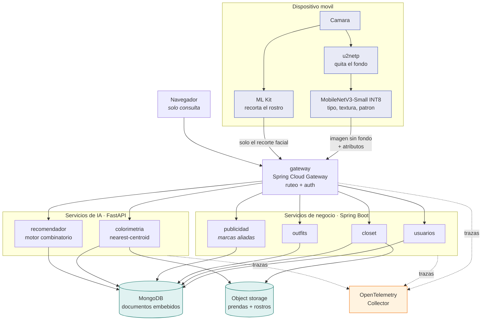
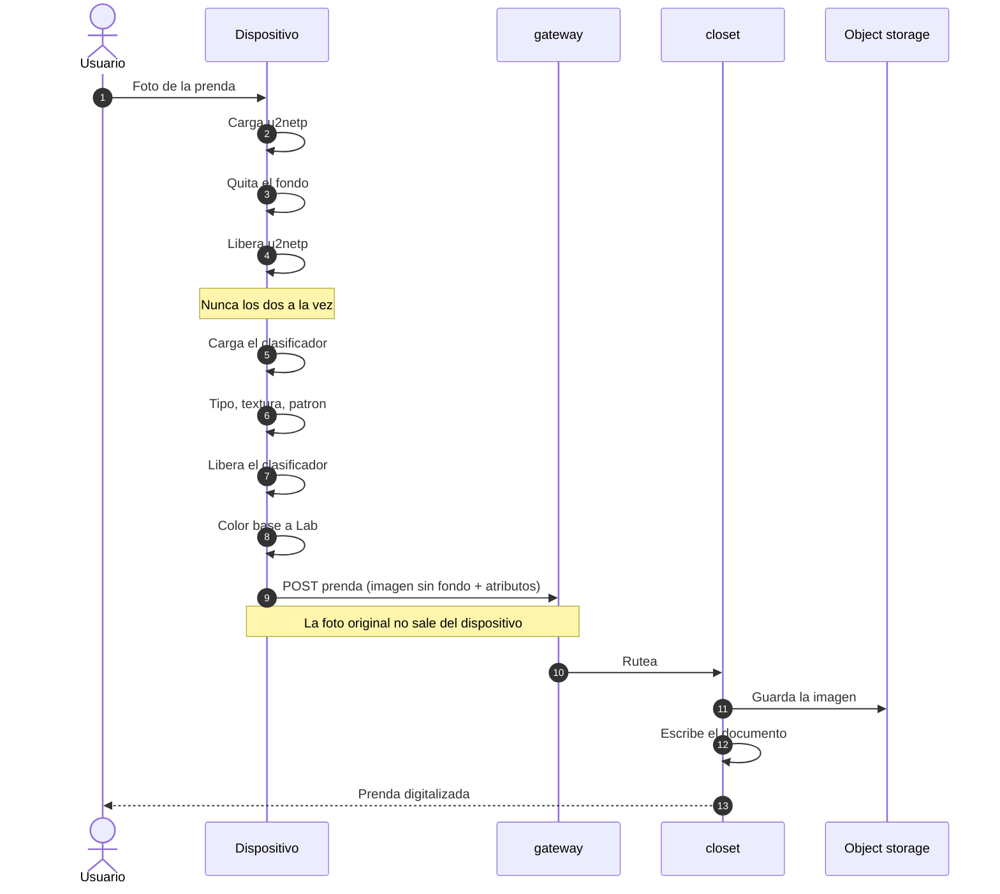
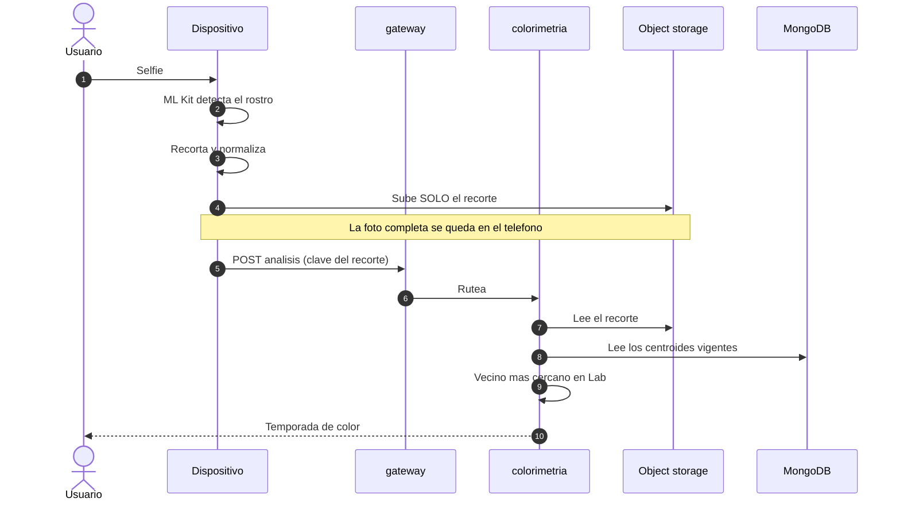
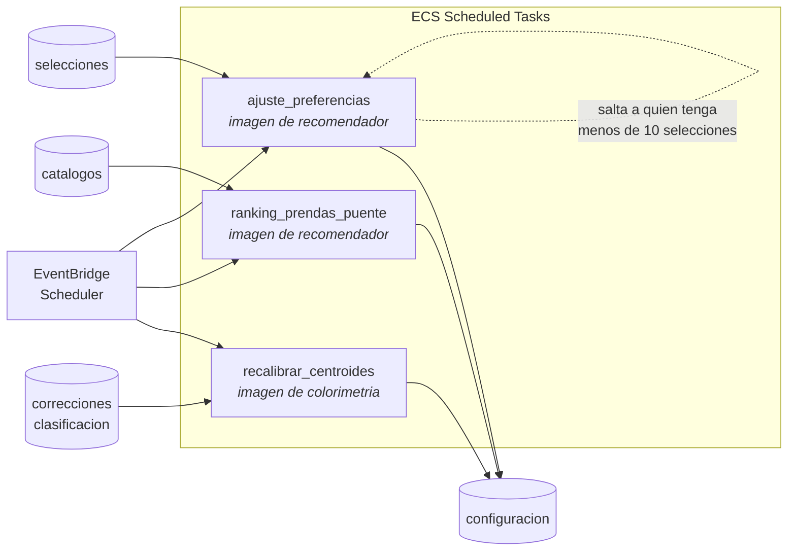
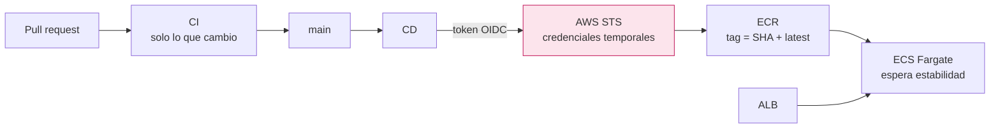

# Arquitectura de WearHack

Diagramas as-code. Si cambian, cambian aqui, no en una imagen que nadie puede
editar.

## Vista general

Lo que hay que quedarse de este diagrama: **la clasificacion de prendas no cruza
la red**. Pasa entera en el dispositivo, y al backend solo sube la imagen ya
procesada. Ver [ADR 0002](adr/0002-clasificacion-de-prendas-on-device.md).

## Digitalizar una prenda

Los interpretes se cargan **de uno en uno**, no a la vez. Con los dos en memoria,
los telefonos de gama media-baja matan el proceso, y son justo los que hay que
soportar.

## Colorimetria

Es la unica parte de IA que corre en el backend. Aun asi, lo que viaja es solo
el recorte. Ver [ADR 0016](adr/0016-solo-el-recorte-facial-sale-del-dispositivo.md).

## Los jobs nocturnos

Corren con la misma imagen del servicio y distinto comando. Ver
[ADR 0011](adr/0011-jobs-batch-como-tareas-programadas-de-ecs.md).

## Como se despliega

## Puertos en local

| Servicio | Puerto |
|---|---|
| gateway | 8080 |
| usuarios | 8081 |
| closet | 8082 |
| outfits | 8083 |
| publicidad | 8084 |
| colorimetria | 8091 |
| recomendador | 8092 |
| MongoDB | 27017 |
| MinIO | 9000, consola en 9001 |
| OpenTelemetry Collector | 4317 gRPC, 4318 HTTP |

Solo el 8080 hace falta. Los demas se publican para poder depurar un servicio
suelto, no porque el cliente los use.
